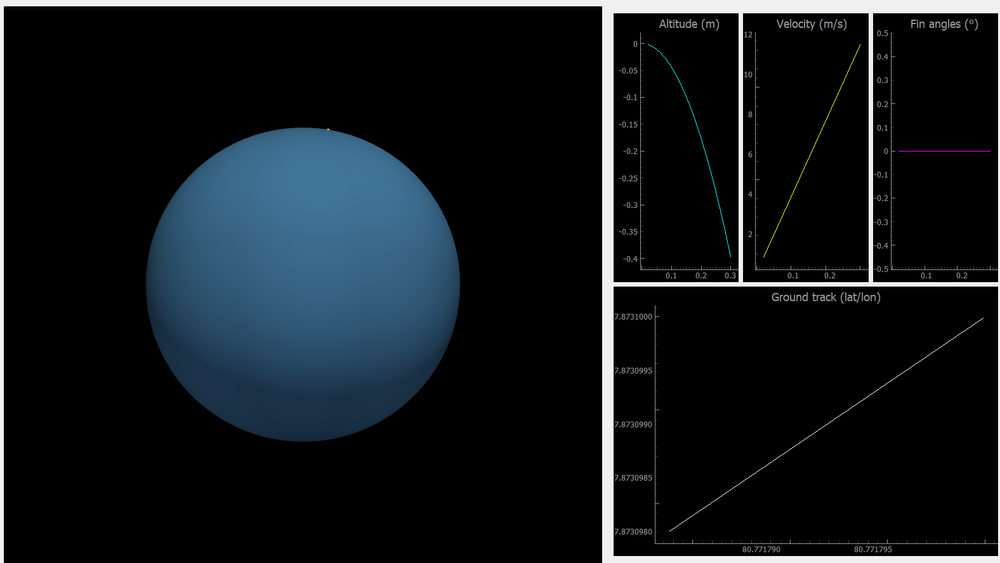
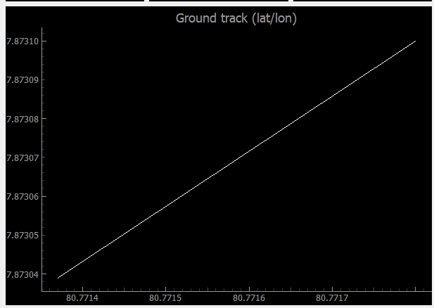
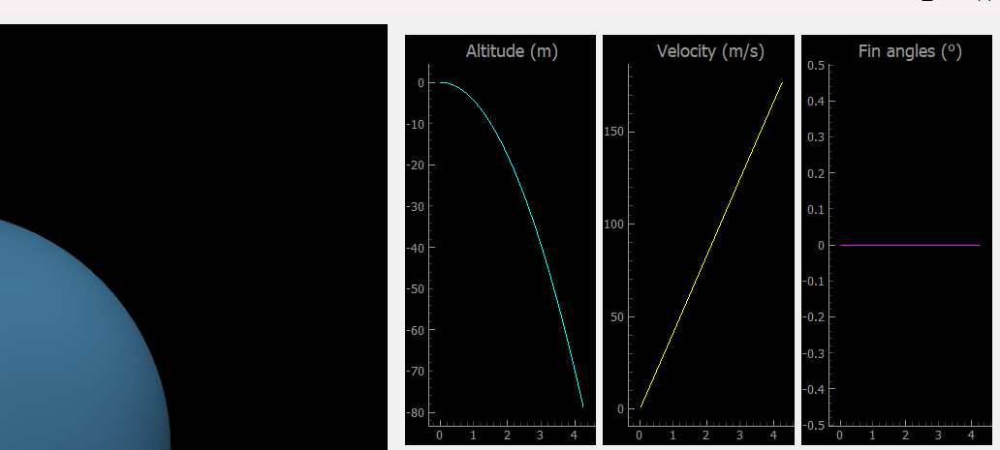

# 🛰️ Orbital & Space Simulation Dashboard

A comprehensive Python-based 3D orbital mechanics simulator, atmospheric modeler, and real-time telemetry dashboard. This system simulates spacecraft physics, communications, and orbital trajectories with an interactive 3D globe visualization.



## ✨ Key Features

* **3D Globe Visualization (`globe3d.py`):** Interactive 3D rendering of Earth and orbital paths in real time.
* **Orbital Mechanics & Physics (`orbital.py`, `physics.py`):** Accurate calculation of gravitational forces, trajectories, velocity vectors, and orbital parameters.
* **Atmospheric Modeling (`atmosphere.py`):** Simulates atmospheric density, drag effects, and altitude-dependent environmental variables.
* **Communications System (`comms.py`):** Models telemetry data transmission, signal latency, and ground-station communication links.
* **Interactive Telemetry Dashboard (`dashboard.py`):** Live monitoring of mission-critical data, graphs, and system status.
* **Modular Configuration (`config.py`):** Easily customize simulation constants, initial orbital parameters, and UI settings.

---

## 📸 Screenshots

| Telemetry View 01 | Telemetry View 02 |
| :---: | :---: |
|  |  |

---

## 📂 Project Structure

```text
├── atmosphere.py          # Atmospheric density and drag calculations
├── comms.py               # Telemetry and communication link simulation
├── config.py              # Global configuration and simulation constants
├── dashboard.py           # Main UI and telemetry visualization dashboard
├── globe3d.py             # 3D Earth and trajectory rendering engine
├── main.py                # Application entry point
├── orbital.py             # Orbital mechanics and propagation algorithms
├── physics.py             # Core physics engine and force calculations
├── dashboard.png          # Main dashboard preview image
├── dashboard_veiw_01.png  # Dashboard view 01 screenshot
├── dashboard_view_02.png  # Dashboard view 02 screenshot
├── LICENSE                # Project license
└── README.md              # Project documentation

https://github.com/myworkbench-0001/rocket_hil.git
python main.py